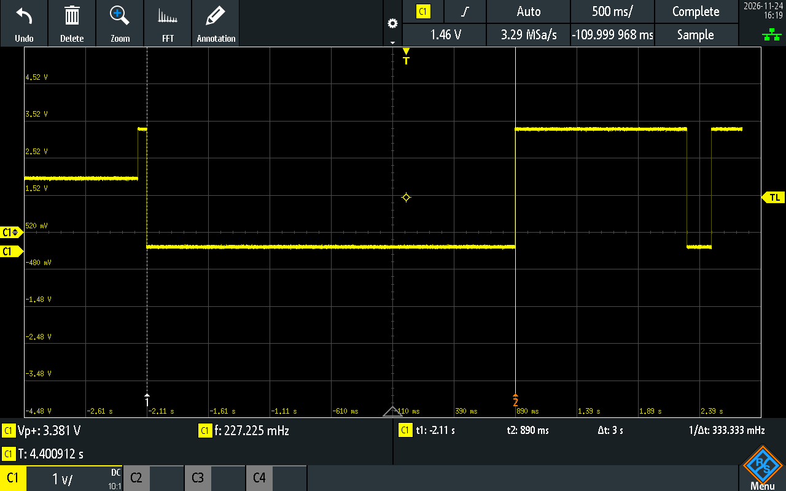
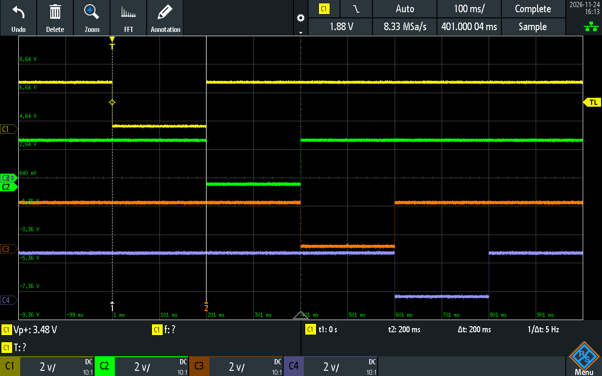

# MINF_TP0_LedAd
Bienvenu dans le ReadMe du TP0, ce TP a pour but de se familiariser avec le microcontrôleur PIC32MX795F512L et sont environnement de développement MPlabX IDE en faisant un chenillard avec 8 LEDs et en lisant la valeur d'un ADC.
## Configuration du timer 1
La valeur de recharge du timer 1 a été calculer avec la formule si dessous :

$$
T_{tick} = \frac{SYSCLK}{Pre \cdot Freq} - 1 = \frac{80\,\text{MHz}}{256 \cdot 10\,\text{Hz}} - 1 = 31249
$$

**SYSCLK** : Fréquence de l'horloge du PIC.

**Pre** : valeur du prescaler du PIC.

**Freq** : Fréquence de interruption du timer.

**T*tick*** : valeur du registre de reload.

J'ai utiliser un prescaler de 256 pour ne pas dépasser la valeur de 16 bits du timer 1.

## Méthode de mesure

**Mesure 3 seconde :**

Réglage de l'oscilloscope :

 - CH1 : LED0 en mode CC 1V/Div
 - Base de temps : 500 ms/Div

Maintenir le bouton reset et le relâcher affin de mesurer l’état de démarrage. Avec les curseurs, mesurer le temps ou les LEDs restent allumées et faire un oscillogramme de cette mesure.

**Mesure chenillard :**

Réglage de l'oscilloscope :
	

 - CH1 : LED0 en mode CC 2V/Div
 - CH2 : LED1 en mode CC 2V/Div
 - CH3 : LED2 en mode CC 2V/Div
 - CH4 : LED3 en mode CC 2V/Div
 - Base de temps : 100 ms/Div

Trigger sur le flanc descendant de la sonde CH1, arranger les quatre signaux sur l'écran de manière clair. Avec les curseurs mesurer le temps de la LED0 et faire un oscillogramme de cette mesure.

*A noter que sur les mesures la LED et allumer quant le signal et a l’état bas !*
## Mesure 3 seconde
 
 Sur cette mesure on peut voir au tout début que le reset reste maintenu pendant une demi seconde, avent d’être relâcher. Ensuite, pendant un petit temps, on voir que la LED reste éteinte, avent de s'allumer pendant les 3 seconde demandé avent de se reteindre et de commencer son cycle.
## Mesure chenillard

Ici, on peut voir le début du paterne du chenillard, comme la base de temps et de 100 ms par division, on peut voir très clairement que chaque LEDs reste allumées les 200 ms demandé.

## Conclusion
Le programme fonctionne correctement comme demander dans le TP, le chenillard effectue le bon paterne dans le bon timing et les trois seconde de démarrage sont respectée.
La lecture de l'ADC se fait aussi sans problème, nous avons bien les valeur de 0 à 1023 se qui correspond aux 10 bits des convertisseurs.
Cependant, j'ai eu beaucoup de problème avec la prise en main de MPlabX, notamment le BSP qui disparaissait à chaque fois que je chargeais le configurateur graphique ce qui faisait qu'a chaque génération du code par le configurateur il me remplaçait les fichier et le déclaration BSP par d'autre se qui corrompais mon projet et qu'il a fallu recommencer trois fois.
Pour palier a se problème je n'ai généré qu'une seul fois le code par le configurateur et je ne l'ai pas retoucher du projet.

## Fichiers
Tous les fichiers de programmation du projet sont disponible dans le dossier firmware.
